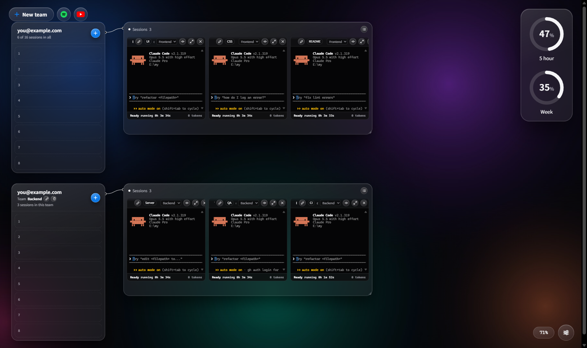

# Session Board

Run many AI coding CLI sessions side by side on one board, with music and video while they work.

> 여러 개의 AI 코딩 CLI 세션(Claude Code, Codex, Gemini, Antigravity)을 한 판에 띄워 놓고, 기다리는 동안 음악이나 영상을 트는 Windows용 무료 작업판입니다.

**Status: early prototype (0.1.0).** Built for Windows first. Expect rough edges.



## What it does

- **Real terminals on a canvas.** Each session is the real CLI in a real terminal (node-pty + xterm.js). Group sessions into team boxes, drag, resize and zoom.
- **Four tools.** Claude Code, Codex, Gemini CLI and Antigravity. Claude Code gets the most features for now.
- **Who needs you.** Claude Code sessions show working, waiting for you, or done, driven by Claude Code's own hooks. The tab title counts sessions that are waiting.
- **Team rules and roles.** Give a team a few rules and each session a role. They are added to new Claude Code sessions as a system prompt.
- **Usage at a glance.** 5-hour and weekly limit rings, tokens per session.
- **Daily recap.** After midnight, a card shows yesterday's tokens (input and output, no cache), sessions and active work time across all your Claude Code use.
- **Phone control.** Start a Claude Code session with Remote Control on and continue it from the Claude app.
- **Music and video.** Spotify and YouTube players on the board.
- **Liquid Glass theme.** Pick a WebGL glass engine with three presets, or SVG refraction that bends everything behind the glass (heavier on the GPU).
- **Commit with a key check.** Scans your changes for API keys and secrets before committing.

Everything runs locally on `127.0.0.1`. Session Board reads your local CLI logs and never sends them anywhere. Each CLI uses your own login and plan.

## Requirements

- Windows 10 or 11
- At least one CLI installed and signed in: [Claude Code](https://claude.com/claude-code), [Codex](https://github.com/openai/codex), [Gemini CLI](https://github.com/google-gemini/gemini-cli) or Antigravity
- To run from source: Node.js 24 or later

Running many sessions at once uses your plan's limits quickly. A higher-tier plan helps.

## Run from source

```
git clone https://github.com/stomacha/session-board
cd session-board
npm install
start.bat
```

`start.bat` starts the server on `127.0.0.1:4777` and opens it in an Edge app window.

## Build the Windows app

```
cd desktop
npm install
npm run dist
```

The installer lands in `dist/`. It is not code-signed yet, so Windows SmartScreen will warn you: choose **More info → Run anyway**.

## Credits

- Inspired by the "one board for many agents" idea of [Symvibe](https://www.symvibe.com/) (macOS). Session Board is an independent project with its own code and design, and is not affiliated with Symvibe.
- The WebGL Liquid Glass engine (`glass/`) was written with GPT-6 Astra as an independent implementation.
- Not affiliated with or endorsed by Anthropic, OpenAI or Google. Claude, Codex, Gemini and Antigravity are trademarks of their owners.

## License

[MIT](LICENSE)
